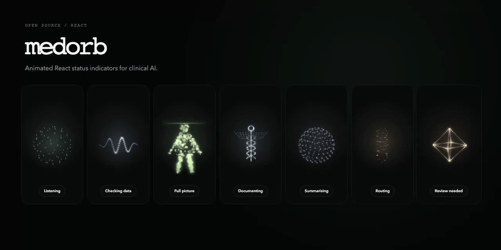

# medorb

A motion system for clinical AI work.

[Live playground](https://alberthammerich.github.io/medorb/) ·
[npm](https://www.npmjs.com/package/medorb) ·
[Run the example](https://stackblitz.com/github/alberthammerich/medorb/tree/main/examples/vite?file=src%2FApp.tsx)

[](https://www.npmjs.com/package/medorb)
[](https://www.npmjs.com/package/medorb)
[](https://github.com/alberthammerich/medorb/actions/workflows/ci.yml)

<a href="https://alberthammerich.github.io/medorb/">
  
</a>

Open-source React status indicators for clinical AI and medical workflows.
Each state has its own motion language and a plain-language accessible label.

## Install

```bash
npm install medorb
```

## Use

```tsx
import { MedOrb } from "medorb";
import "medorb/styles.css";

<MedOrb state="checking" size={72} />
```

[`Open this example in StackBlitz →`](https://stackblitz.com/github/alberthammerich/medorb/tree/main/examples/vite?file=src%2FApp.tsx)

## Switch states

```tsx
import { useState } from "react";
import {
  MedOrb,
  medicalWorkflowStates,
  type MedicalWorkflowState,
} from "medorb";
import "medorb/styles.css";

export function WorkflowSignal() {
  const [state, setState] = useState<MedicalWorkflowState>("listening");

  return (
    <>
      <MedOrb state={state} size={96} />

      {medicalWorkflowStates.map((next) => (
        <button key={next} onClick={() => setState(next)}>
          {next}
        </button>
      ))}
    </>
  );
}
```

## States

| State | Signal |
| --- | --- |
| `listening` | Stream open |
| `checking` | Reading records |
| `full-picture` | Joining context |
| `documenting` | Drafting note |
| `summarizing` | Building brief |
| `routing` | Next step |
| `review-needed` | Clinician needed |

## Props

| Prop | Type | Default |
| --- | --- | --- |
| `state` | `MedicalWorkflowState` | required |
| `size` | `number` | `72` |
| `label` | `string` | accessible state label |
| `speed` | `number` | `1` |
| `className` | `string` | `""` |

Reduced motion is built in. The orb is a polite live region, so screen
readers announce each state change. Motion signals activity—not clinical
certainty.

## Develop

```bash
npm install
npm run dev
npm run check
```

## Release

Core package changes require a version bump. After they land on `main`, the
release workflow tests and publishes to npm, then creates the GitHub release
and tag as its final step.

Inspired by working with and contributing to
[OpenMed](https://openmed.life/). Built and open-sourced by
[Albert Hammerich](https://github.com/alberthammerich).

MIT. Interface component only; not a medical device or clinical guidance.
